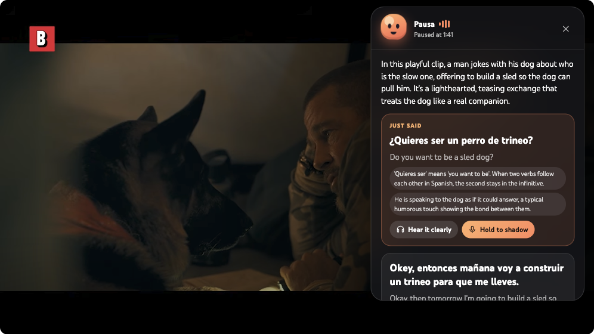

# Pause & Effect

**You just watch. It builds your study program.**

Learners turn shows into study material by hand: pause, look it up, make flashcards, find practice. Pause & Effect is a Chrome extension plus a Wasp app that does all of it while you watch YouTube in the language you're learning. The language is auto-detected (tested with Spanish and Mandarin).



## The pipeline

1. **Watches alongside you.** When a video opens, the server downloads the first 3 minutes (yt-dlp), transcribes it with **ElevenLabs Scribe** (language auto-detected, word timestamps) and separates the dialogue with **ElevenLabs Voice Isolator**. The extension also reads the on-screen captions live.
2. **Explains on pause.** Pause and a mascot appears over the video. **Claude** translates the last few lines and adds notes on slang, grammar and the scene, and **ElevenLabs TTS** reads the summary aloud.
3. **Builds your deck.** Every line you paused on becomes a card at `/deck`, ranked by how often you stopped there.
4. **Turns it into practice.** *Hear it clearly* plays just the voice (music removed) at 0.75×. *Shadowing*: say the line, and Scribe scores you word by word with a coloured diff and pace.

## Architecture

```
YouTube tab
  └─ content script (captions buffer, pause/play, shadow-DOM overlay, mic recorder)
       └─ background service worker (all fetches, 8 s timeouts, offline cache)
            └─ Wasp server :3001
                 ├─ /ext/session → yt-dlp → ffmpeg → Scribe + Voice Isolator
                 ├─ /ext/explain → Claude (structured JSON) → ElevenLabs TTS
                 ├─ /ext/shadow  → Scribe → word-level LCS score
                 ├─ /media/{videoId}/dialogue.mp3, explain-{t}.mp3
                 └─ Prisma (SQLite): Video, Moment, ShadowAttempt, User
            Wasp web app :3000 → /deck, /practice (getDeck, submitShadow)
```

## Partner tools

- **ElevenLabs:** Scribe (video transcript + shadowing scores), Voice Isolator ("Hear it clearly"), text-to-speech (mascot voice, stock voice).
- **Wasp:** the API endpoints the extension talks to, auth, Prisma entities, and the `/deck` + `/practice` pages with a query and an action.

## Run it

```bash
# Backend (localhost:3001, web app on :3000)
cd wasp-app
cp .env.server.example .env.server   # fill in ELEVENLABS_API_KEY, ANTHROPIC_API_KEY
wasp db migrate-dev
wasp start

# Extension
cd extension
npm i && npm run build
# chrome://extensions → Developer mode → Load unpacked → select extension/
```

Then open a YouTube video in any language and pause. **Full demo guide: [DEMO.md](DEMO.md).** Plan and design notes: [CLAUDE.md](CLAUDE.md).

Tests: `npm test` in `extension/` (segment window) and `wasp-app/` (shadow scoring).
