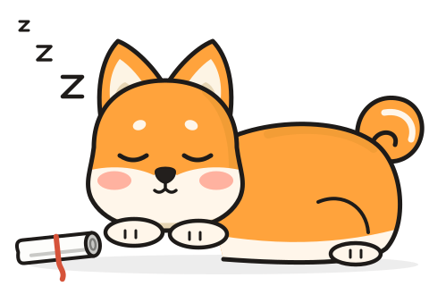
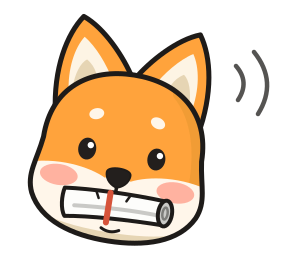
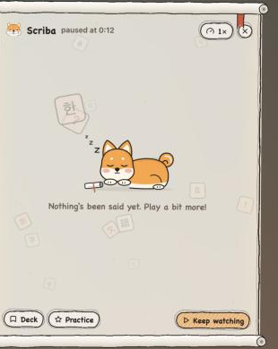
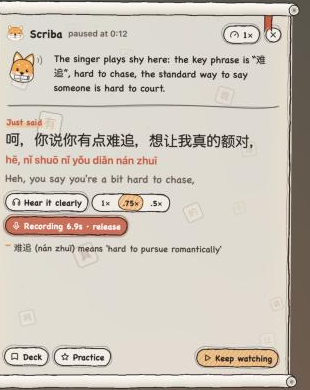

# Scriba Inu: new poses (brief for the artist)

Scriba now has two new poses in the extension. The drawings in there today are quick SVG placeholders made to match your original. Please draw the real ones. When you drop your PNGs into `extension/assets/`, the extension uses them instead, with no code change.

| | Original (yours) | Sleeping (placeholder) | Listening (placeholder) |
|---|---|---|---|
| Drawing |  |  |  |
| Your file | `scriba-inu.png` | **`scriba-sleeping.png`** | **`scriba-listening.png`** |

Keep everything from the original: the thick dark outline, the orange and cream fur, the cream brow dots, the pink cheeks, and the white scroll with its red ribbon.

## 1. Sleeping

**When it shows:** the learner paused, but nothing has been said to explain yet ("Nothing's been said yet. Play a bit more!"). It's the only thing on the scroll, so it's the biggest Scriba anyone sees.

- **Pose:** the whole dog, lying down like a loaf, chin resting on its front paws, eyes shut, curled tail. The scroll is set down beside it, ribbon trailing. Add a few "z"s. The placeholder shows one way to do it; any sleeping pose you like is fine.
- **Size on screen:** about **150–170 px wide**, centred, with one line of text under it. The cream paper background shows through, so anything that isn't the dog must be transparent.
- **Must read at that size:** closed eyes, the "z"s, the scroll.
- **Canvas:** landscape, about **3:2** (for example 2400 × 1600), transparent background, the dog filling most of it with a little margin. The extension scales it to fit, so the exact pixel size doesn't matter.

## 2. Listening

**When it shows:** while the learner holds **Hold to shadow** and says the line out loud. It replaces the normal head next to Scriba's note for those few seconds, then switches back.

- **Pose:** head only, framed **exactly like the original**, so the swap doesn't jump. Ears up, eyes open and attentive, head tilted a little toward the speaker. Keep the scroll in its mouth. Add a sound mark by the ear if you like (the placeholder has two arcs).
- **Size on screen:** about **60 px wide**, the same as the original's head today.
- **Must read at that size:** open eyes and perked ears, which are what tell it apart from the normal head.
- **Canvas:** the same as the original export (`extension/assets/scriba-inu.png` is 640 × 603, cropped close around the head), transparent background, the head in the same place.

## Dropping the files in

1. Export transparent PNGs named exactly `scriba-sleeping.png` and `scriba-listening.png`.
2. Put them in `extension/assets/`, next to the SVG placeholders. Keep the SVGs as a fallback, or delete them once your versions are in.
3. Rebuild and reload the extension (`cd extension && npm run build`, then reload it at `chrome://extensions`).

How it works: the overlay asks for `scriba-<pose>.png` first and falls back to `scriba-<pose>.svg` if it isn't there (`setPose()` in `extension/src/overlay.ts`).
